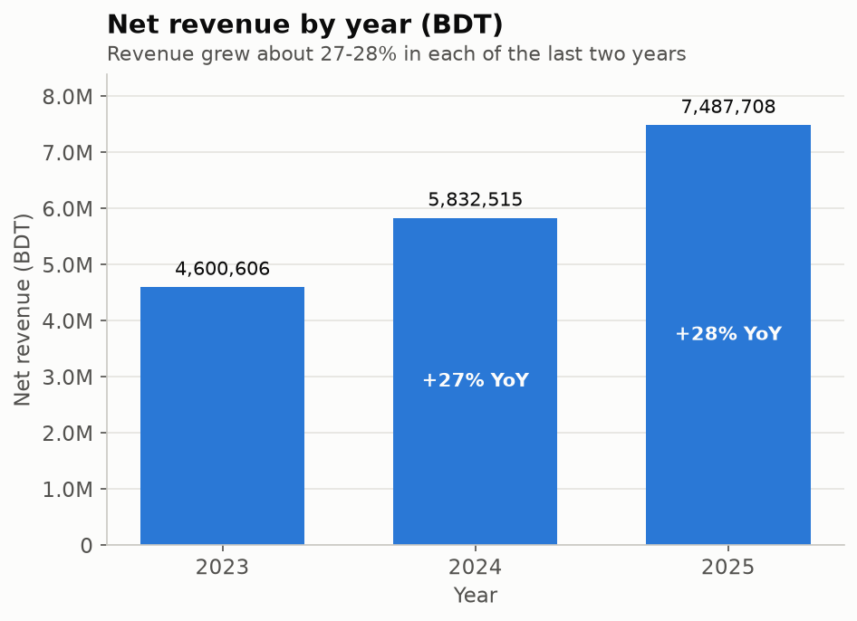
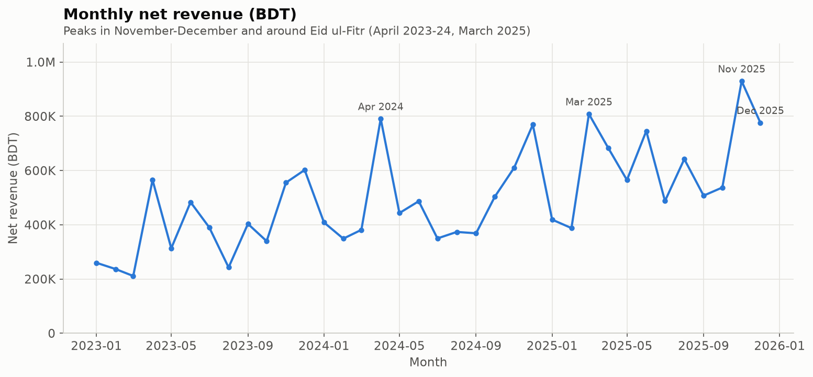
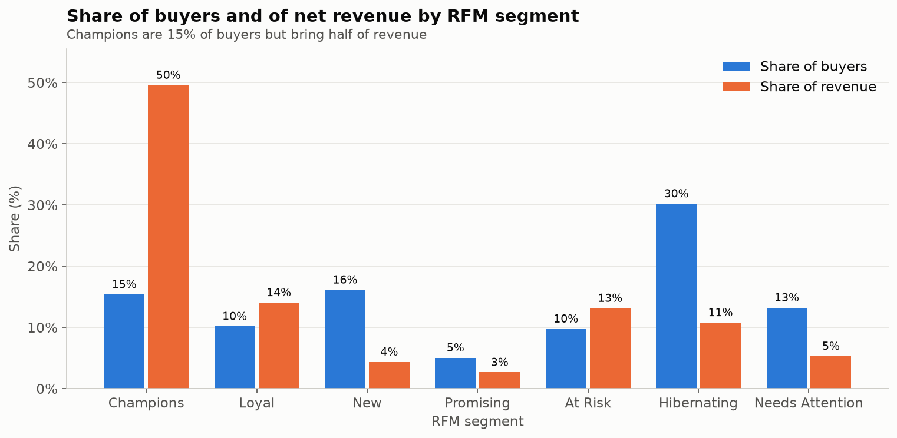
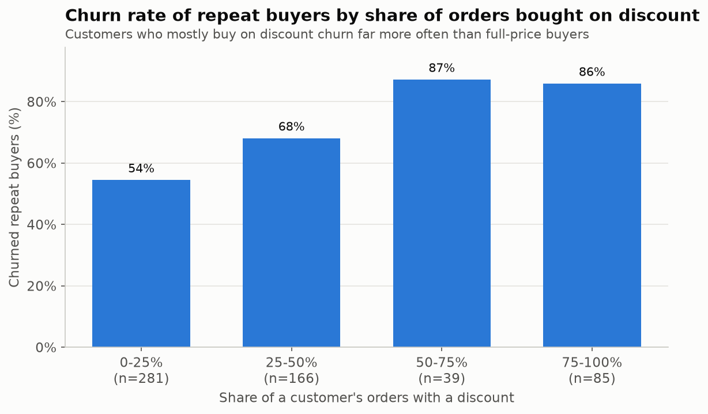
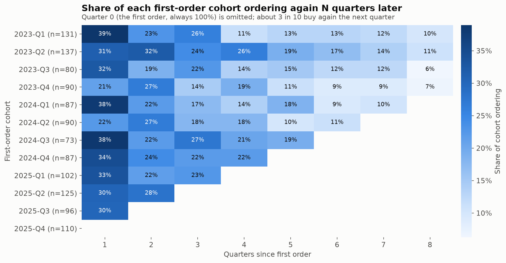
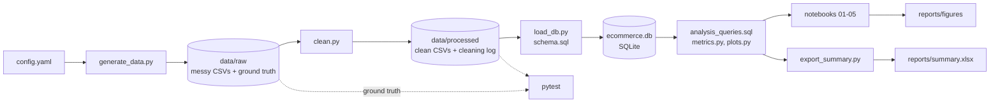

# E-commerce Sales & Customer Analytics

An end-to-end analysis of a Bangladeshi online retailer: where revenue comes from, which
customers are valuable, who is churning, and what the business should do about it.

The project covers the full workflow:

1. Generate a realistic, deliberately messy dataset.
2. Clean it with every step logged and tested.
3. Load it into a SQLite database.
4. Analyse it with SQL and Python.
5. Report the results in notebooks, an Excel summary and a written set of recommendations.

> **The data is synthetic.** No real customers, orders or companies are involved. See
> [Dataset](#dataset) for how it was generated and why.

## Problem statement

An online retailer selling across all eight divisions of Bangladesh wants to know:

1. How fast is revenue growing, and what drives the growth?
2. When and where do customers buy, and which categories matter most?
3. Which customers are most valuable, and how concentrated is revenue?
4. Who stops buying, what goes with churn, and who should be contacted now?
5. How well are new customers retained, and does it depend on how they were acquired?

## Key findings

The full write-up, with recommendations, is in [reports/insights.md](reports/insights.md).

**Revenue grew 27-28% a year, driven entirely by new buyers.** Net revenue reached 7.49M BDT
in 2025. Buyers rose from 438 to 614 while average order value stayed at about 4,500 BDT.



**Demand peaks in November-December and before Eid.** November and December bring 23.7% of
annual revenue. Friday-Saturday, the local weekend, sees 25% more orders per day, and 46% of
orders arrive after 18:00.



**Revenue is concentrated.** The top 20% of buyers produce 66% of revenue. The "Champions"
segment is 15% of buyers and 50% of revenue.



**Churn goes with discount dependence.** Among repeat buyers, 86-87% of those who buy mostly
on discount churned, against 54% of those who rarely do. Heavy returners and
affiliate-acquired customers also churn more.



**Retention drops sharply after the first order, and has not improved.** 45% of buyers never
order again. 32% of new buyers order in the next quarter, and 9% are still ordering two years
later. Affiliate customers retain worst.



**Recommended actions:**

- a second-order programme for new buyers;
- personal outreach to 91 at-risk customers holding 16.9% of past revenue;
- judging acquisition channels on 12-month value, not first-order cost;
- a controlled test of the discount policy;
- cutting Fashion and Footwear returns, which cause 51% of refunds.

## Dataset

All data is generated by [src/generate_data.py](src/generate_data.py) from parameters in
[config.yaml](config.yaml), with a fixed seed so every run is identical. It describes
**January 2023 to December 2025** and every table stays under 10,000 rows.

| Table | Rows (raw) | Contents |
|---|---|---|
| customers | 1,500 | Bengali names (Faker `bn_BD`), gender, phone, division, district, acquisition channel, signup date |
| categories | 10 | Fashion, Electronics, Groceries and seven more |
| products | 300 | name, category, brand, list price |
| orders | 4,040 | customer, timestamp, status, discount, delivery district |
| order_items | 8,762 | product, quantity, unit price |
| payments | 4,000 | method (cash on delivery, bKash, Nagad, card, bank transfer), amount, status, date |
| returns | 676 | order line, date, reason, refund |

**How the generator works.**

- **Customers:** each customer gets a hidden behaviour type (loyal, high-value, regular,
  discount-seeker, seasonal or one-time). Sign-ups arrive at a rate that grows each year.
- **Orders:** customers order month by month according to their type, the season (Eid,
  11.11, 12.12, November-December), the weekday and the hour.
- **Churn:** each month a customer may stop buying. The probability rises with time since
  their last order, discount dependence and return tendency, and it depends on acquisition
  channel.
- **Prices:** log-normal per category.
- **Returns:** the rate depends on category (Fashion high, Groceries low) and on the customer.

The business patterns (growth, the Pareto effect, churn) are not hard-coded. They emerge
from these rules, and [src/validate_data.py](src/validate_data.py) checks they landed in
realistic ranges.

**Deliberate data quality issues** were injected so cleaning has real work to do:

- 3% missing values, more likely for one-time buyers, older orders and grocery brands;
- 1% duplicate orders;
- four date formats;
- casing and whitespace noise;
- old district spellings (Chittagong, Jessore) and typos;
- negative quantities, impossible dates and 100x price errors;
- orphan foreign keys.

Every injected issue is written to a hidden ground-truth log, which lets the tests prove
that cleaning caught all of them.

## Architecture



```
config.yaml              all parameters: volumes, seasonality, behaviour types, messiness, analysis settings
src/
  common.py              config, logging, CSV loading, mixed-format date parsing
  generate_data.py       synthetic data simulation
  messiness.py           data quality issue injection with ground-truth log
  validate_data.py       sanity report on the generated data
  clean.py               cleaning pipeline with per-step row and revenue logging
  load_db.py             SQLite load with foreign keys enforced
  metrics.py             named SQL queries, Pareto, RFM, churn and cohort functions
  plots.py               shared chart style and helpers
  export_summary.py      builds reports/summary.xlsx
sql/
  schema.sql             tables, keys, constraints, indexes
  analysis_queries.sql   named analysis queries (CTEs, window functions)
notebooks/               01 data quality, 02 EDA, 03 RFM, 04 churn, 05 cohorts
reports/                 figures/, summary.xlsx, insights.md
tests/                   cleaning, pipeline, database and metric tests
```

## How to run

Requires Python 3.11+. From the project root:

```bash
python -m venv .venv
.venv\Scripts\activate          # Windows; on macOS/Linux: source .venv/bin/activate
pip install -r requirements.txt

python -m src.generate_data     # 1. synthetic raw data + ground-truth logs  -> data/raw
python -m src.validate_data     #    optional: check the generated patterns
python -m src.clean             # 2. cleaning pipeline + cleaning log       -> data/processed
python -m src.load_db           # 3. SQLite database                         -> data/ecommerce.db
python -m pytest                # 4. 31 tests, incl. revenue reconciliation
python -m src.export_summary    # 5. Excel summary                           -> reports/summary.xlsx
jupyter lab                     # 6. open notebooks/01 ... 05 and run top to bottom
```

The whole pipeline runs in under a minute. Generated data and the database are gitignored
because they can be rebuilt exactly from the seed.

## Methods worth knowing

- **Cleaning is verified, not assumed.**
  - Each step logs rows and revenue before and after, so the change from raw revenue
    (21.3M) to clean revenue (17.9M) is explained step by step.
  - A test rebuilds each order's total from its cleaned lines and compares it with the
    payment system's independent record: 99.4% match to the taka. The rest are explained
    by one known cleaning step.
- **Dates are parsed with explicit formats.** Guessing silently swaps day and month on
  values like `05/03/2024`.
- **SQL does the heavy lifting.** The analysis queries use CTEs and window functions:
  running totals, `LAG` for month-over-month and year-over-year growth, `RANK` within
  years, and `ROW_NUMBER` with `LAG` for gaps between orders.
- **Churn is defined from the data.** A customer is churned after 140 days without an
  order, which is the 90th percentile of real repeat gaps. Customers too new to judge are
  excluded rather than counted as active. Against the hidden ground truth the label is
  right for 92% of customers.
- **RFM frequency uses fixed bins** (1, 2, 3, 4-5, 6+ orders), because half of buyers have
  one order and quintiles of tied values would be arbitrary.
- **Churn drivers are measured on repeat buyers only.** A one-order customer's discount
  share is always 0% or 100%, which would create a false signal.

## Limitations

- **The data is synthetic.** The analysis shows the method; it doesn't describe a real
  market. Patterns were designed into the generator and then rediscovered.
- **Small samples.** Many segments and cohorts hold only 40-140 customers. Across random
  seeds, year-over-year growth varied by about ±6 points.
- **Churn is inferred** from silence with a chosen threshold. It is not observed.
- **Driver results are correlations.** Causal claims, such as "discounts cause churn",
  need an experiment.
- **No cost data,** so the analysis covers revenue, not profit.

## What I would do next

- Run the pipeline at full scale (200k customers, about 1.2M orders). The generator and
  cleaning code already work in chunks.
- Fit a churn model, for example logistic regression on the same features, to score every
  customer's risk instead of using groups.
- Add product costs and delivery fees to analyse margin by category and channel.
- Design the discount holdout experiment from the recommendations, with a power
  calculation for the sample size needed.
- Add a dashboard on top of the SQLite database for monthly monitoring.
